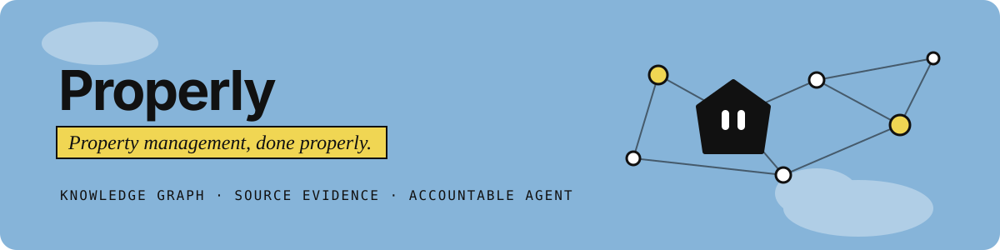
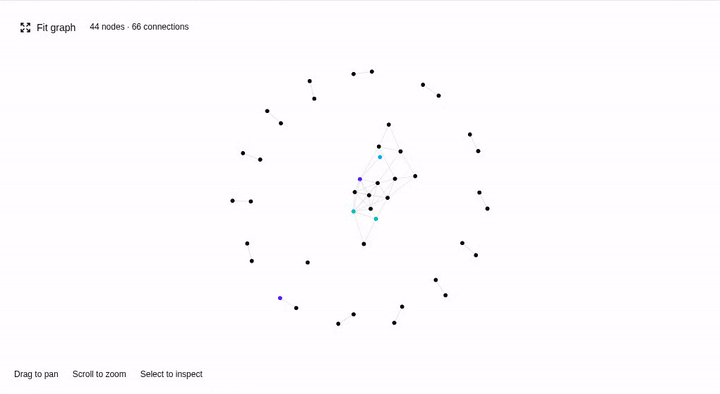
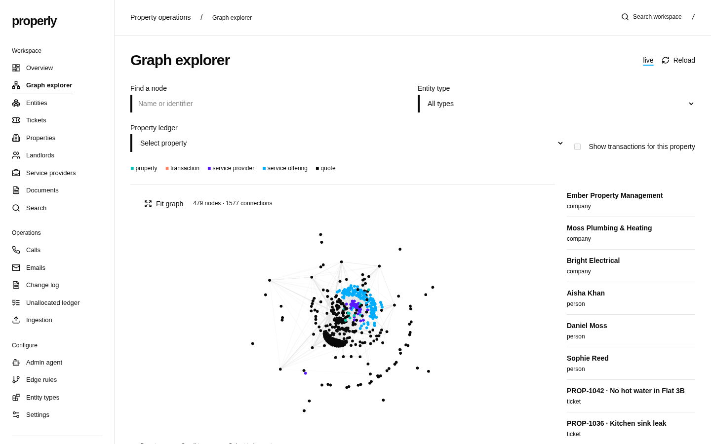
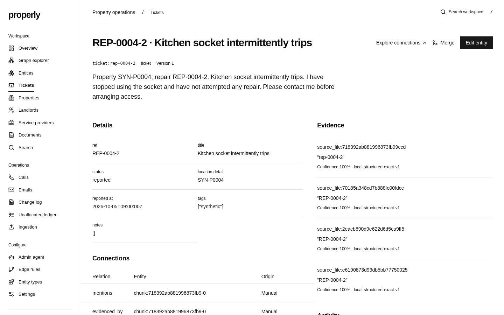
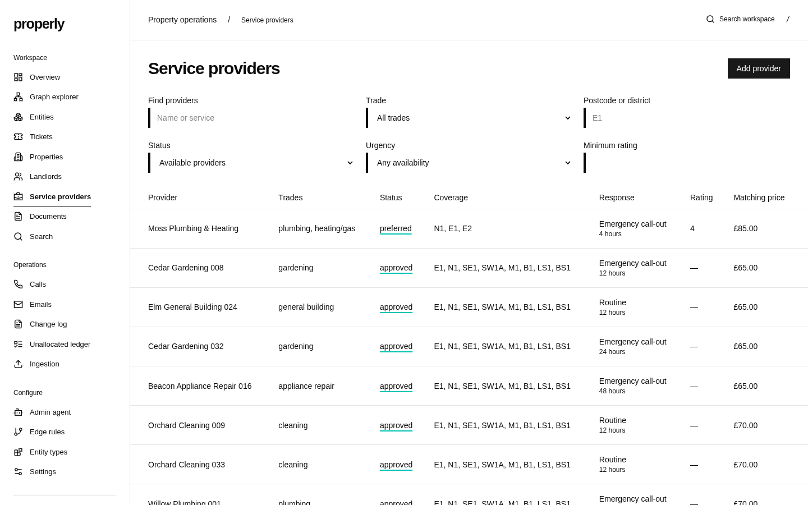
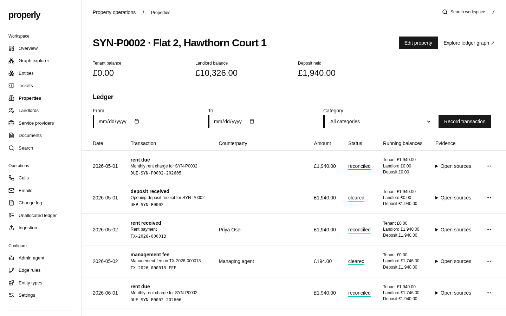
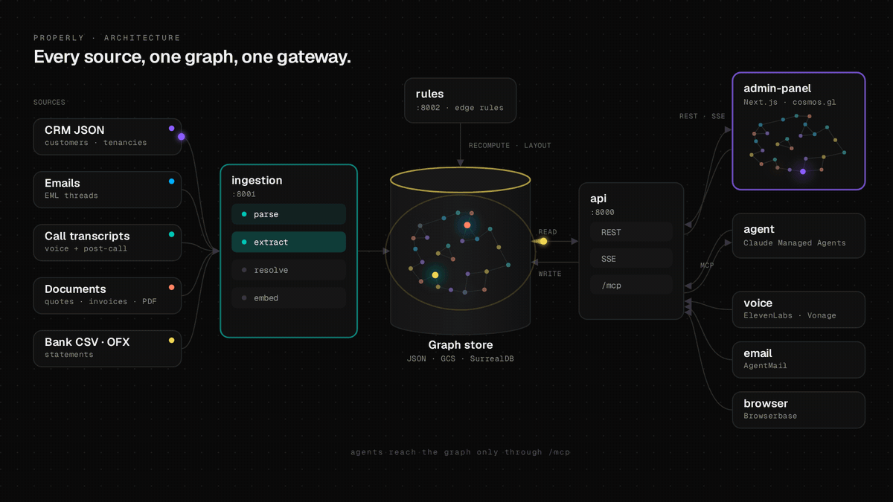
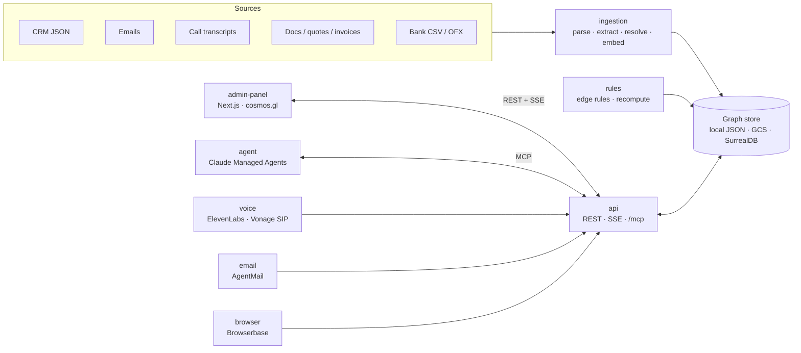

<div align="center">



<br>

[](pyproject.toml)
[](services/)
[](services/admin-panel/)
[](services/admin-panel/components/screens/graph.tsx)
[](services/agent/)
[](docs/MCP.md)
[](infra/)

**Every call, email, invoice and bank line about a property, in one graph an agent can act on.**

[**▶ Watch the demo**](#-see-it-run) · [**Run it locally**](#run-locally) · [**Product brief**](PRD.md) · [**Contributing**](AGENTS.md)

</div>

---

A letting agency runs on a hundred small promises. The tenant at Flat 3B rang about
the boiler on Monday. The plumber's quote came by email on Tuesday. The landlord
approved it in a reply nobody filed. The invoice arrived on Friday and the payment
went out with the wrong reference. Each fact is true, and each lives somewhere
different: a phone log, three inboxes, a PDF, a bank export, the CRM.

Nobody has one view of who a customer is, what was promised and what changed — and
without that view an AI agent cannot act safely. It would book the wrong contractor,
chase rent that was already paid, or email a landlord about a job that closed last week.

**Properly** ingests every source about a portfolio into a typed knowledge graph,
links each fact back to the exact span of text it came from, and gives an agent one
audited door into that graph. The agent answers tenants, books contractors, chases
arrears and reconciles the books; every action it takes is recorded with the reason
it gave, and can be undone.

**Who it is for.** The property manager who needs to know the whole story of a flat
before picking up the phone. The operations lead watching agents work and stepping
in when a case is genuinely ambiguous. The bookkeeper reconciling rent, repairs and
landlord statements. The admin who decides what an "entity" is and how they connect.
[More on each below](#who-its-for).

## ▶ See it run

**[Watch or download Properly Demo v1](Properly%20Demo%20v1.mov)** (MOV).
The original recording is stored in the repository root using Git LFS.

<div align="center">

[](docs/media/demo.mp4)

<sub>The real admin panel against the local stack: synthetic property sources streaming
through ingestion, the graph explorer updating live over SSE, with the rules service
recomputing layout between batches. <a href="docs/media/demo.mp4">MP4</a></sub>

</div>

## What it actually does

| | |
| --- | --- |
| **Ingests everything** | CRM exports, tenancy agreements, maintenance emails (EML), call transcripts, contractor quotes and invoices, bank CSV/OFX. Re-uploading a source is idempotent. |
| **Resolves identity** | Mentions are matched to one canonical entity by hard keys first (email, phone, CRM id, postcode + flat), then embeddings and model adjudication. One "Moss Plumbing & Heating", however it is spelled. |
| **Keeps the evidence** | Every field and edge points at the document and character span it came from. The document viewer highlights it. |
| **Connects by rules** | Admins write edge rules in plain English ("link people to the company whose domain matches their email"); they compile to an editable, versioned spec with a preview before anything runs. |
| **Runs the books** | Append-only property ledgers, daily rent accrual, automatic fees, reconciliation of bank lines to charges, an unallocated-payments queue and evidence-backed PDF statements. Balances are derived, never typed in. |
| **Knows the trades** | A provider directory with coverage areas, accreditations, sourced prices, quotes and ticket assignments, ranked for a given job and postcode. |
| **Lets an agent act** | One Claude Managed Agents session per case, reaching the graph, tickets, ledger, email, phone and browser through a single MCP gateway. No approval queue; every tool call is logged with its session and stated reason. |
| **Shows it live** | A GPU-rendered graph explorer, entity pages, ticket and property views, call and email logs, and an undoable change log — all updating in real time. |

## Who it's for

| Role | What they do in Properly |
| --- | --- |
| **Property manager** | Opens a property or tenant and sees tenancy, tickets, calls, emails, quotes and balance on one page, each with its source. |
| **Operations lead** | Watches agent runs, reads the change log, and undoes or corrects anything that looks wrong. Never asked to rubber-stamp routine work. |
| **Bookkeeper** | Works the unallocated ledger, checks reconciliations and downloads landlord statements built from the ledger. |
| **Admin / analyst** | Defines entity types and typed fields, writes edge rules, and edits the operational skills agents follow. |
| **The agent** | Reads and writes the graph only through `/mcp`, with a short-lived session token — never database credentials. |

## The experience, start to finish

<table>
<tr>
<td width="50%"></td>
<td width="50%"></td>
</tr>
<tr>
<td><b>1. The graph forms.</b> Sources stream in; properties, tenants, landlords, providers, tickets, quotes and transactions appear and link up live. Filter by type, or pick a property to see its ledger in the graph.</td>
<td><b>2. A case has context.</b> A ticket links to the tenant who reported it, the property, the call and emails about it, the quote and the provider — each fact citing its source.</td>
</tr>
<tr>
<td></td>
<td></td>
</tr>
<tr>
<td><b>3. The right contractor.</b> Providers are ranked by trade, postcode coverage, urgency, rating and sourced price for this job.</td>
<td><b>4. The money adds up.</b> Rent, repairs and fees land in an append-only ledger with running balances, reconciled against the bank and traceable to evidence.</td>
</tr>
</table>

With the agent configured, it takes it from there: it triages the email, books the contractor, calls the tenant
to confirm access, records the quote and closes the ticket with a final answer — and
every step lands in the [change log](#how-actions-stay-accountable).

## Technical implementation

### Architecture

<div align="center">

<a href="docs/media/architecture.mp4"></a>

<sub>Sources are parsed, extracted, resolved and embedded into one graph store. The rules
service recomputes edges and layout, the API serves REST and SSE to the admin panel, and
agent, voice, email and browser work all enter through the API, with agents limited to
the single <code>/mcp</code> gateway. <a href="docs/media/architecture.mp4">MP4</a> ·
<a href="docs/media/src/architecture.html">source</a></sub>

</div>



| Service | Port | Role |
| --- | --- | --- |
| [`api`](services/api/) | 8000 | REST, live graph SSE, the single MCP gateway at `/mcp`, auth and session grants |
| [`ingestion`](services/ingestion/) | 8001 | Parse, extract, resolve, chunk and embed sources; financial parsers for bank/invoice data |
| [`rules`](services/rules/) | 8002 | Versioned edge rules, preview and recompute |
| [`agent`](services/agent/) | 8003 | Thin orchestrator for Claude Managed Agents sessions: routing, wake-ups, relay |
| [`voice`](services/voice/) | 8004 | Outbound/inbound calls via ElevenLabs over the existing Vonage number; post-call transcripts back into ingestion |
| [`email`](services/email/) | 8005 | AgentMail inboxes, send/reply, inbound webhooks |
| [`browser`](services/browser/) | 8006 | Browserbase sessions with vaulted, domain-locked credentials |
| [`admin-panel`](services/admin-panel/) | 3000 | Next.js App Router, TanStack Query, generated OpenAPI client, cosmos.gl graph |
| [`landing`](landing/) | 3001 | Marketing page and signup form |

Shared domain logic lives in [`packages/core`](packages/core/src/propadmin_core/) (graph,
ingestion, ledger, providers, search, layout) and
[`packages/runtime`](packages/runtime/src/propadmin_runtime/) (FastAPI app factory,
routes, auth, MCP, observability). Schemas and migrations are in [`db/`](db/);
Terraform and deployment scripts in [`infra/`](infra/).

### The data model

Canonical entity types each have a fixed, typed schema plus a free-text description,
editable from **Entity types** in the admin panel: person, company, property, ticket,
quote, call, email, transaction, service provider, service offering, skill and
workflow issue, among others. Source files are stored, chunked and embedded; chunks
link to the entities they mention. Every free-text field is embedded, so
[hybrid search](packages/core/src/propadmin_core/search.py) combines vector,
full-text and graph expansion and returns citations.

Graph positions are computed server-side by a deterministic, seeded layout and
shipped as a compact binary snapshot, so the explorer loads instantly and stays
stable as nodes are added. See [Addendum A notes](docs/ADDENDUM-A-IMPLEMENTATION.md)
for property identity, ledger and provider decisions.

### How actions stay accountable

- **One door.** Agents reach the graph only through the API's `/mcp` endpoint, with a
  signed, expiring, revocable per-session token. See [MCP.md](docs/MCP.md).
- **Reasons are required.** Every mutation carries a reason and is recorded with actor
  `agent_run:<session_id>`, including reads and failures.
- **Optimistic concurrency.** Updates and merges check versions; stale writes fail and
  the agent re-reads instead of overwriting.
- **Undo.** The change log keeps previous and resulting values; undo is audited and
  conflict-protected.
- **Money is append-only.** Ledger entries cannot be edited by general entity tools,
  merges or undo — only reversed with a new entry.
- **Skills are versioned.** Thirteen seeded operational skills (triage maintenance,
  book a contractor, call a tenant, rent arrears, reconcile ledger, landlord statement,
  choose provider and more) live in the graph; agents propose changes, they do not
  edit live versions.

### Autorefinement through hill climbing

The workflow-tuning implementation is in development and has not yet been
published to `main`. The process below describes that implementation.

Workflow skills improve through an automated loop: **predict → grade → revise →
validate → regress → publish**. Open **Configure → Performance tuning** (`/tuning`)
in the admin panel and select **Start tuning**. The loop needs an imported workflow
corpus with at least ten eligible transitions and configured model credentials.
The default trial limit is 200 and can be changed before starting.

1. **Predict:** choose a random original case and a random history cutoff whose
   next recorded event is an agent action. A fresh evaluation-only agent receives
   the history prefix and frozen current skills, then returns one next action and
   a concise, evidence-based explanation. External replies are observations,
   never prediction targets.
2. **Grade:** Haiku compares the prediction with the recorded next action.
   Passing requires an overall score of at least 80, no critical error, and at
   least 80 each for action, facts, recipient/channel and sequence. Equivalent
   wording is accepted.
3. **Revise:** after a miss, a separate correction session uses the answer,
   explanation and grading differences to propose one small replacement in one
   skill. Old and new text are each limited to 2,000 characters. A new skill is
   allowed only when no existing skill covers the workflow. Corrections must
   generalize without storing case identifiers or reference answers.
4. **Validate and regress:** a fresh predictor retests the failed sample with
   the candidate, then reruns up to ten distinct previously passing samples.
   Any miss rejects the candidate and leaves the live skills unchanged.
5. **Publish:** a passing candidate automatically becomes a new immutable
   skill version, with its exact edit, validation evidence, case provenance and
   audit record. No human approval is required. Version checks prevent publishing
   against skills that changed during testing.
6. **Repeat:** misses and published changes reset the success streak. The loop
   stops after ten distinct transitions pass consecutively under the same skill
   versions, at the trial limit, on an error, or when **Stop tuning** is selected.

The predictor can read other cases and current skills only through the API's
existing `/mcp` gateway. The selected case, all its revisions, sources and derived
records are hidden, along with prior evaluations and private tests. Email, calls,
browser access and operational writes are unavailable; predicted actions are
never executed. Progress is durable, so closing the browser does not stop a run.
`make dev` starts the tuning tick inside the API; real predictions require model
credentials, and missing configuration is reported before a job starts.

Ten consecutive passes are a stopping rule, not proof of performance on unseen
cases. Tuning uses all original corpus cases, including the older replay holdout.
Use **Test an unseen case** for fresh JSON cases or pasted histories; these tests
stay outside the knowledge graph, never change skills and do not count toward
the streak. An optional reference next step enables grading.

### Models, APIs and external services

| Purpose | Service | Configured by |
| --- | --- | --- |
| Agent loop and sandbox | Claude Managed Agents (`claude-sonnet-5-5` by default) | `ANTHROPIC_API_KEY`, `MANAGED_AGENT_ID`, `MANAGED_ADMIN_AGENT_ID`, `MANAGED_ENVIRONMENT_ID`, `AGENT_MODEL` |
| Extraction, resolution tie-breaks, rule compiler | Claude API | `EXTRACTION_PROVIDER`, `PIPELINE_MODEL` |
| Embeddings | Vertex AI `gemini-embedding-001` (1536 dims) | `EMBEDDING_PROVIDER`, `EMBEDDING_MODEL`, `EMBEDDING_DIMENSIONS`, `GOOGLE_CLOUD_PROJECT`, `VERTEX_LOCATION` |
| Voice | ElevenLabs Agents over a Vonage SIP trunk | `ELEVENLABS_*` — see [voice setup](services/voice/README.md) |
| Email | AgentMail | `AGENTMAIL_API_KEY`, `AGENTMAIL_DOMAIN`, `AGENTMAIL_INBOXES`, `AGENTMAIL_WEBHOOK_SECRET` |
| Browser | Browserbase | `BROWSERBASE_API_KEY`, `BROWSERBASE_PROJECT_ID` |
| Graph database (cloud) | SurrealDB 3.x | `SURREAL_*` |
| Hosting | Cloud Run, Cloud Storage, Cloud Tasks, Pub/Sub, Secret Manager via Terraform | [`infra/`](infra/README.md) |
| Analytics (optional) | PostHog | `POSTHOG_PROJECT_TOKEN`, `POSTHOG_HOST` |

Without credentials, extraction and embeddings run in explicit **deterministic offline
modes** (`local-structured-exact-v1`, `local-deterministic-hash-v1`), and the agent,
voice, email and browser services return clear `503 not configured` responses instead
of pretending.

## Run locally

**Prerequisites:** Python 3.12+, [uv](https://docs.astral.sh/uv/), Node 20.9+ and pnpm.
No cloud credentials are needed.

```sh
git clone https://github.com/Fergus-MW/propadm.in.git
cd propadm.in
make dev
```

`make dev` installs locked dependencies, seeds synthetic data into `.data/state.json`
and starts **all eight services plus the landing page**, waiting for each to be
healthy before printing its URLs. Open **http://127.0.0.1:3000** and sign in with
**`propadmin-local`**. Ctrl-C stops everything; if one service fails the others stop
too. Python services and the Next.js frontend hot-reload on source changes.

| | |
| --- | --- |
| Admin panel | http://127.0.0.1:3000 |
| Landing page | http://127.0.0.1:3001 |
| API (OpenAPI at `/docs`) | http://127.0.0.1:8000 |
| Ingestion · rules · agent · voice · email · browser | 8001 · 8002 · 8003 · 8004 · 8005 · 8006 |

Occupied default ports move automatically; use the URLs printed at startup. Set
`API_PORT`, `ADMIN_PORT` or `<SERVICE>_PORT` to pin a port.

**Containers.** `make dev-docker` runs the same stack in Docker with source mounts and
hot reload; `make stop` removes the containers and keeps the data volume. Run one stack
at a time.

### Configuration

Copy [`.env.example`](.env.example) to `.env` to override defaults; shell environment
values win over `.env`. The essentials:

| Variable | Default | Purpose |
| --- | --- | --- |
| `PROPADMIN_MODE` | `local` | `local` uses the file-locked JSON store; cloud mode requires shared storage |
| `PROPADMIN_DATA_PATH` | `.data/state.json` | Local data file, or `gs://bucket/state.json` in cloud mode |
| `ADMIN_PASSWORD` | `propadmin-local` | Admin panel and API login |
| `TOKEN_SECRET`, `INTERNAL_SERVICE_TOKEN` | local values | Signing and service-to-service auth — set strong values before exposing anything |
| `EXTRACTION_PROVIDER`, `EMBEDDING_PROVIDER` | `local` | Switch to Claude / Vertex once credentials are present |

Provider variables are listed in the [models and services table](#models-apis-and-external-services).

### Load a bigger portfolio

The seed is deliberately small. A reproducible synthetic portfolio of **120 properties,
240 tenants, 36 providers, 480 tickets, 480 call transcripts and 1,000 emails** (3,288
source files) ships in [`eval/portfolio`](eval/portfolio/README.md):

```sh
python3 -m zipfile -e eval/portfolio/data/large-portfolio-001.zip .artifacts
uv run --locked python eval/portfolio_data.py ingest \
  --pack .artifacts/large-portfolio-001 --platform-root . \
  --out .artifacts/my-combined-check --mode combined --save-state \
  --property SYN-P0001 --property SYN-P0003
```

The importer runs the real ingestion routes in-process against an isolated store,
blocks outbound HTTP and verifies relationships, balances and idempotent replay. It
never touches your running `.data/state.json`.

### Run a batch of cases

[`infra/scripts/run_cases.py`](infra/scripts/run_cases.py) runs a manifest of cases
concurrently against a configured agent deployment, keeps going when one fails, and
exports one `ANSWER.md`, `REASONING.md` and `trace.jsonl` per case from Cloud Logging.
See [observability](docs/OBSERVABILITY.md) for the manifest format and evidence layout.

### Checks

```sh
make test     # Python, admin-panel and landing tests
make check    # + lint, types, production build, Terraform/Compose validation, API contracts
pnpm --dir services/admin-panel generate:api   # regenerate the typed OpenAPI client
```

Latest local results are recorded in [VERIFICATION.md](docs/VERIFICATION.md).

## Assumptions

- Source data is the synthetic environment (CRM, email, call, document and bank
  exports); there is no live sync with production systems in v1.
- Money is GBP in integer pence. Properties are identified by address + flat and
  postcode; providers by company identity and coverage districts.
- The agent is trusted to act without an approval step, so safety comes from
  scoped tools, required reasons, versioned writes, append-only money and undo
  rather than human sign-off.
- One agent definition handles every case; voice, email and browser are tools of that
  agent, not separate agents.

## Known limitations

- **Local storage is a JSON file.** Fine for development and demos; the deterministic
  layout is O(n²) and ingestion slows noticeably past a few hundred entities. Cloud
  mode needs the GCS adapter or SurrealDB.
- **Offline extraction is structural.** Without Claude configured, extraction relies on
  structured sources and exact keys; free-text understanding needs the model.
- **Provider integrations are configured, not exercised here.** The agent, voice,
  email and browser adapters are covered by mocked-provider tests; real Managed Agents,
  ElevenLabs, AgentMail and Browserbase sessions need credentials and were not run in
  local verification.
- **Portfolio importer vs. completed tickets.** Ticket sources marked completed without
  a `final_answer` are now rejected (`422`), so some pre-generated portfolio repairs
  don't import against current `main`.
- **Local uploads don't trigger a relayout.** Entities from `/v1/ingest/upload` appear
  in the explorer at the origin until the rules service runs
  (`POST :8002/internal/recompute`, or the rules job in cloud).
- **No mobile app**, no model fine-tuning, and PDF/DOCX OCR is not part of the local path.

## What we'd build next

- Swap the JSON store for SurrealDB in production, with LIVE queries feeding the SSE
  stream and Barnes-Hut (or GPU) layout for portfolios in the thousands.
- Live connectors for the CRM, shared inboxes and open banking instead of exports.
- Tenant and landlord portals that read from the same graph, with the same evidence.
- Reality-tested escalation policies: learned thresholds for when a case should go to
  a human, measured against outcomes.
- Skill evolution from workflow issues — agents propose skill changes from reversals
  and failures, and admins review the diff.

## Where to read next

| | |
| --- | --- |
| [PRD.md](PRD.md) · [Addendum A](PRD-ADDENDUM-A.md) | Product requirements and the property/ledger/provider extension |
| [ADDENDUM-A-IMPLEMENTATION.md](docs/ADDENDUM-A-IMPLEMENTATION.md) | How the addendum was implemented and why |
| [MCP.md](docs/MCP.md) | The graph gateway, session grants and every tool |
| [BUILD-CONTRACT.md](docs/BUILD-CONTRACT.md) | Shared contracts between services |
| [OBSERVABILITY.md](docs/OBSERVABILITY.md) | Tracing, case batches and evidence export |
| [VERIFICATION.md](docs/VERIFICATION.md) | What has been verified, and how |
| [ANSWERS/](ANSWERS/README.md) | Reality Test answers for the 30 Property Management cases, one folder per case with ANSWER.md, REASONING.md and trace.json |
| [infra/README.md](infra/README.md) | Local supervisor, Terraform and Cloud Run deployment |
| [design.md](design.md) | Admin panel design rules |
| [AGENTS.md](AGENTS.md) | Rules for contributors, human or otherwise |

## Property manager portal

The admin app opens on Today, with Inbox, Maintenance, Viewings, Calendar and
Availability alongside the existing graph tools. See [portal workflows, demo
and integration limits](docs/portal.md). Start everything with `make dev`.
